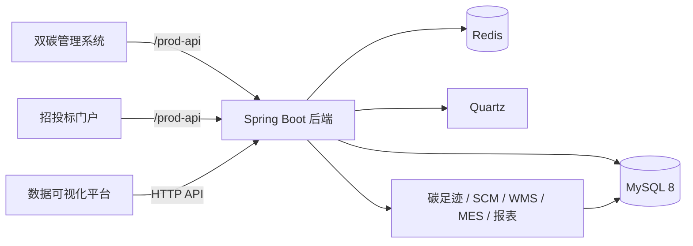

# 双碳管理系统（Carbon Management System）

> 面向制造企业的「碳足迹核算 + 供应链协同 + 智能仓储 + 制造执行 + 招投标 + 数据可视化」一体化管理平台。


---

## 项目简介

本项目是一套面向制造企业的双碳管理平台，围绕企业碳足迹、能源消耗、供应链、仓储、生产执行和招投标业务，提供从基础数据、业务单据到报表大屏的完整链路。

系统由四个可独立部署的应用组成：

| 应用 | 目录 | 说明 |
| --- | --- | --- |
| 后端服务 | `carbon/` | Spring Boot + MyBatis + MySQL，提供全部业务接口 |
| 双碳管理系统 | `双碳管理系统/` | Vue 2 + Element UI 后台管理端 |
| 双碳招投标网子系统 | `双碳招投标网子系统/` | 招投标门户，包含招标信息、投标、企业信息、投诉、政策法规 |
| 双碳数据可视化平台 | `双碳数据可视化平台/` | DataV + ECharts 数据大屏 |

## 功能概览

### 双碳管理后台

| 业务域 | 主要能力 |
| --- | --- |
| 碳足迹 / 排放 | 排放源、排放因子、固定排放、变化排放、碳中和配置、预预警 |
| 碳电管理 | 用电检查点、能耗采集、设备/产品能耗明细 |
| 供应链 SCM | 供应商、采购申请、采购计划、采购合同、采购到货、采购退货、销售合同、销售订单、销售发货、销售报表 |
| 智能仓储 WMS | 物料分类、物料档案、仓库信息、库区、库存、入库申请、出库申请、补货申请、盘点、移库 |
| 制造执行 MES | 工厂模型、设备、BOM、生产计划、生产完成、产品质检、设备点检/保养 |
| 招投标 | 招标信息、投标管理、企业信息、投诉、政策法规、平台动态 |
| 报表 / 大屏 | 销售总览、客户排名、销售统计、计划完成率、能耗/碳排放分析、可视化大屏 |
| 系统管理 | 用户、角色、菜单、部门、字典、参数、日志、定时任务、代码生成 |

### 招投标门户

- 招标信息公告
- 企业注册与信息维护
- 投标报名 / 投标文件
- 投诉与处理
- 政策法规、平台动态

### 数据可视化

- 销售 / 采购 / 库存 / 能耗 / 碳排放指标
- 销售趋势、客户排名、计划完成率
- 大屏轮播、图表联动

## 技术栈

| 层次 | 技术 |
| --- | --- |
| 后端 | Java 8、Spring Boot 2.2.12、Spring Security、MyBatis、Druid、PageHelper |
| 数据库 | MySQL 8.x |
| 缓存 / 调度 | Redis、Quartz |
| 管理端 | Vue 2.6、Element UI 2.14、ECharts 5、Axios、Vue Router、Vuex |
| 招投标门户 | Vue 2.6、Element UI、ECharts、Vue Router |
| 数据可视化 | Vue 2.6、DataV、ECharts、Sass |
| 接口文档 | Swagger / Knife4j |
| 权限 | RuoYi 角色、菜单、按钮权限体系 |

## 系统架构



## 项目结构

```text
carbon-management-system/
├── carbon/                          # Spring Boot 后端
│   ├── neu-admin/                   # 启动模块、系统管理接口
│   ├── neu-carbon-bid/              # 招投标
│   ├── neu-carbon-footprint/        # 碳足迹 / 排放
│   ├── neu-carbon-mes/              # 制造执行 MES
│   ├── neu-carbon-report/           # 报表 / 大屏接口
│   ├── neu-carbon-scm/              # 供应链 SCM
│   ├── neu-carbon-wms/              # 智能仓储 WMS
│   ├── neu-carbon-service/          # 业务 Service
│   ├── neu-carbon-mapper/           # Mapper / Domain / XML
│   ├── neu-common/                  # 公共模块
│   ├── neu-framework/               # 安全 / 数据源 / Web 配置
│   ├── neu-generator/               # 代码生成
│   ├── neu-quartz/                  # 定时任务
│   ├── carbon.sql                   # 数据库脚本
│   └── pom.xml
├── 双碳管理系统/                     # 后台管理端
├── 双碳招投标网子系统/                # 招投标门户
├── 双碳数据可视化平台/                # 数据大屏
├── README.md
└── .gitignore
```

## 快速开始

### 1. 环境要求

- JDK 8
- Maven 3.8+
- MySQL 8.x
- Redis 6+
- Node.js 16+（Vue CLI 4 项目建议 Node 16）
- npm 8+

### 2. 初始化数据库

```bash
mysql -uroot -p -e "CREATE DATABASE IF NOT EXISTS \`carbon\` DEFAULT CHARACTER SET utf8mb4 COLLATE utf8mb4_general_ci;"
mysql -uroot -p carbon < carbon/carbon.sql
```

### 3. 修改后端配置

编辑 `carbon/neu-admin/src/main/resources/application-druid.yml`：

```yaml
url: jdbc:mysql://127.0.0.1:3306/carbon?useUnicode=true&characterEncoding=utf8&zeroDateTimeBehavior=convertToNull&useSSL=false&serverTimezone=GMT%2B8
username: root
password: your-mysql-password
```

编辑 `carbon/neu-admin/src/main/resources/application.yml` 中的 `token.secret` 和 Redis 配置（如与本机不同）。

### 4. 启动后端

```bash
cd carbon
mvn clean package -DskipTests
java -jar neu-admin/target/carbon.jar
```

后端默认地址：`http://localhost:9090`

接口文档：`http://localhost:9090/doc.html`（如已启用 Knife4j）

### 5. 启动前端

#### 双碳管理系统

```bash
cd 双碳管理系统
npm install --registry=https://registry.npmmirror.com
npm run dev
```

默认访问：`http://localhost`（`vue.config.js` 默认端口 80，代理到 `http://localhost:9090`）

#### 双碳招投标网子系统

```bash
cd 双碳招投标网子系统
npm install --registry=https://registry.npmmirror.com
npm run dev -- --port 8081
```

默认访问：`http://localhost:8081`

#### 双碳数据可视化平台

```bash
cd 双碳数据可视化平台
npm install --registry=https://registry.npmmirror.com
npm run dev
```

默认访问：`http://localhost:8080`

> 三个前端默认都使用 80 或 8080 端口，联调时请给不同项目分配不同端口，避免冲突。

## 演示账号

- 默认管理员：`admin` / `admin123`
- 其他演示账号请查看数据库 `sys_user` 表，或在系统「用户管理」中创建。

> 演示账号仅用于本地环境，部署到公网前请修改密码。

## 核心模块说明

### 碳足迹 / 排放

- 维护排放源、排放因子、固定排放、变化排放、碳中和配置。
- 按设备/产品/工厂维度统计能耗与碳排放。
- 为报表和大屏提供碳排放趋势、能耗结构数据。

### 供应链 SCM

- 供应商准入与信息维护。
- 采购申请 → 采购计划 → 采购合同 → 采购到货 → 采购退货。
- 销售合同 → 销售订单 → 销售发货 → 销售退货。
- 采购/销售报表与财务对账。

### 智能仓储 WMS

- 物料分类、物料档案、仓库、库区、库位。
- 入库申请、出库申请、补货申请、盘点、移库。
- 库存明细、库存流水、库存预警。
- 出库申请模块包含完整的 Controller / Service / Mapper / Vue 页面，可作为二次开发示例。

### 制造执行 MES

- 工厂模型、设备台账、BOM、生产计划、生产完成、产品质检。
- 设备点检、保养、故障管理。
- 生产能耗与碳排数据采集。

### 招投标

- 招标信息发布、投标报名、投标文件、企业信息、投诉、政策法规。
- 支持后台审核与门户展示。

### 报表 / 大屏

- 销售总览、客户排名、销售统计、计划完成率。
- 能耗/碳排放趋势、设备/产品能耗明细。
- 数据可视化平台使用 DataV + ECharts 展示大屏。

## 常见问题

### 1. 后端启动报数据库连接失败

检查 `carbon` 数据库是否创建、`carbon.sql` 是否导入，以及 `application-druid.yml` 中的用户名/密码。

### 2. 前端请求 404

检查 `vue.config.js` 中的代理目标是否为 `http://localhost:9090`，并确认后端已启动。

### 3. Node 17+ 启动报 OpenSSL 错误

Vue CLI 4 项目在 Node 17+ 可能报 `ERR_OSSL_EVP_UNSUPPORTED`。可切换到 Node 16，或使用项目脚本中已配置的 `--openssl-legacy-provider`。

### 4. 端口冲突

后端默认 `9090`；管理端和招投标门户默认 `80`，可视化平台默认 `8080`。联调时请通过 `--port` 或 `vue.config.js` 修改。

## 仓库说明

- 当前 `master` 分支已从 Git 索引移除 `node_modules/`、`dist/` 等构建产物，克隆后请在各前端目录执行 `npm install`。
  注意：历史提交中仍保留这些文件，因此 `git clone` 的体积暂时不会明显变小；如需彻底瘦身，可使用 `git filter-repo` 重写历史后强制推送（会改写提交记录，请谨慎）。
- `carbon.sql` 为完整数据库脚本，包含表结构与演示数据。
- 本项目基于 RuoYi 框架二次开发，仅用于学习、课程设计与演示。

## 后续规划

- [ ] 增加碳足迹核算公式配置与因子库版本管理
- [ ] 增加供应链金融/合同履约分析
- [ ] 增加 WMS 库位推荐与波次拣货
- [ ] 增加 MES 设备数据采集（MQTT/OPC UA）
- [ ] 增加报表导出与定时推送
- [ ] 补充自动化测试与接口文档示例

## License

本项目基于 RuoYi（MIT）二次开发，仅用于学习、课程设计与演示。使用前请遵守相关开源协议。
